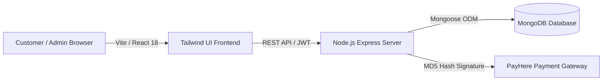
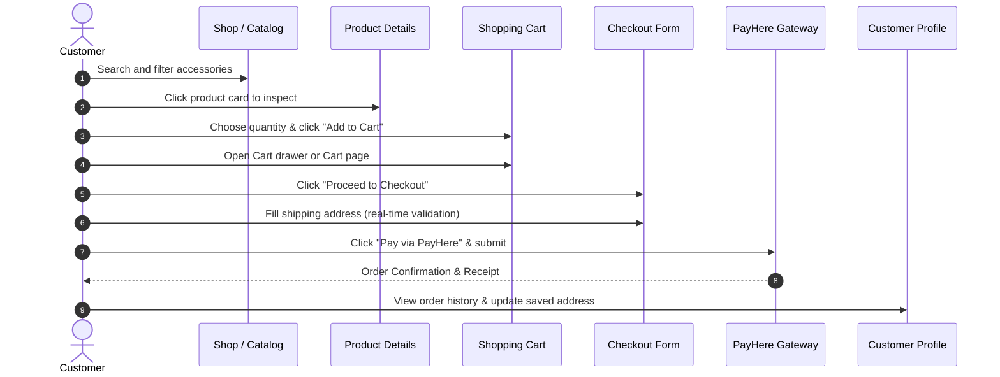

# 📱 nr-accessories.lk — Smartphone Accessories E-Commerce Platform

[](https://nodejs.org/)
[](https://react.dev/)
[](https://www.typescriptlang.org/)
[](https://vitejs.dev/)
[](https://tailwindcss.com/)
[](https://www.mongodb.com/)
[](https://expressjs.com/)
[](https://www.payhere.lk/)

> **Academic Project:** ICT2142 E-Business Systems  
> **Institution:** Faculty of Technology  
> **Student Registration:** `TG/2024/2147`  
> **Platform Domain:** `nr-accessories.lk` (Sri Lanka Mobile Phone Accessories)

---

## 📑 Table of Contents
1. [Platform Overview](#-platform-overview)
2. [Key Capabilities & Highlights](#-key-capabilities--highlights)
3. [System Architecture](#-system-architecture)
4. [Technology Stack](#-technology-stack)
5. [Installation & Local Setup](#-installation--local-setup)
6. [📖 Complete GUI User Manual](#-complete-gui-user-manual)
   - [Part 1: Customer Storefront Experience](#part-1-customer-storefront-experience)
     - [1.1 Browsing & Searching the Catalog](#11-browsing--searching-the-catalog)
     - [1.2 Inspecting Product Details](#12-inspecting-product-details)
     - [1.3 Managing the Cart](#13-managing-the-cart)
     - [1.4 Checkout with Real-Time Validation](#14-checkout-with-real-time-validation)
     - [1.5 Completing Payment via PayHere Sandbox](#15-completing-payment-via-payhere-sandbox)
     - [1.6 Managing Your Customer Profile](#16-managing-your-customer-profile)
   - [Part 2: Store Administrator Manual](#part-2-store-administrator-manual)
     - [2.1 Accessing the Admin Suite](#21-accessing-the-admin-suite)
     - [2.2 Admin Dashboard Overview](#22-admin-dashboard-overview)
     - [2.3 Adding a New Product](#23-adding-a-new-product)
     - [2.4 Editing & Deleting Products](#24-editing--deleting-products)
     - [2.5 Managing & Fulfilling Customer Orders](#25-managing--fulfilling-customer-orders)
7. [Automated Quality Assurance & Verification](#-automated-quality-assurance--verification)
8. [Project File Structure](#-project-file-structure)
9. [License & Acknowledgments](#-license--acknowledgments)

---

## 🌟 Platform Overview

**nr-accessories.lk** is a modern full-stack e-commerce web platform engineered specifically for smartphone accessories in Sri Lanka (cases, fast chargers, braided cables, screen protectors, earbuds, and smartwatches). 

The platform features an ultra-responsive storefront, client-side & server-side form validations with visual feedback, real-time cart persistence across sessions, PayHere payment integration, customer profiles, and a protected Admin Management suite for catalog and inventory tracking.



---

## 🚀 Key Capabilities & Highlights

* 🛍️ **Live Filterable Catalog:** Instant search by title/brand, interactive category selectors, stock tags, and discount badges.
* ⚡ **Cart Persistence:** Multi-item cart backed by React Context and `localStorage` caching with quantity boundary controls.
* ✅ **Real-Time Input Validation:** Touch-friendly 48px form inputs with instant green checkmarks (`✓`) on valid input and helpful error alerts.
* 📱 **Mobile-First Audited (375px+):** Engineered for iPhone SE, 12/13/14/15, and Android devices with zero sideways scrolling, bottom tab navigation, and touch drawers.
* 💳 **PayHere Sandbox Integration:** Automated checkout workflow with backend MD5 hash signature calculation and currency formatting.
* 🛡️ **Role-Based JWT Security:** Secure authentication with encrypted passwords via bcrypt and route guards for Customer vs. Admin privileges.
* 📊 **Admin Back-Office:** Product inventory CRUD management, real-time revenue analytics, and order fulfillment status updates.

---

## 🛠️ Technology Stack

| Layer | Technologies / Libraries |
| :--- | :--- |
| **Frontend Framework** | React 18.2, TypeScript 5, Vite 5.4 |
| **Styling & UI** | Tailwind CSS 3.4, Lucide React Icons, Framer Motion |
| **State & Navigation** | React Context API, React Router v6, LocalStorage Cache |
| **Backend API** | Node.js (v18+), Express.js (MVC Pattern, CommonJS) |
| **Database** | MongoDB, Mongoose 8.x ODM |
| **Authentication** | JSON Web Tokens (JWT), Bcrypt.js |
| **Payment Gateway** | PayHere Payment Gateway (Sandbox Mode, LK) |
| **Testing & Verification** | Puppeteer (Headless Browser Automation), Chrome Mobile Emulation |

---

## ⚙️ Installation & Local Setup

### 1. Prerequisites
- **Node.js**: v18.0.0 or higher ([Download Node.js](https://nodejs.org/))
- **MongoDB**: Local MongoDB instance running on `mongodb://127.0.0.1:27017` or a MongoDB Atlas URI

---

### 2. Backend Setup
1. Open terminal and navigate into the `server` folder:
   ```bash
   cd server
   ```
2. Install dependencies:
   ```bash
   npm install
   ```
3. Create a `.env` file inside `server/` (or copy from `.env.example`):
   ```env
   PORT=5001
   MONGO_URI=mongodb://127.0.0.1:27017/nr-accessories
   JWT_SECRET=nr_accessories_jwt_super_secret_key_2026
   PAYHERE_MERCHANT_ID=your_merchant_id
   PAYHERE_MERCHANT_SECRET=your_merchant_secret
   ```
4. Seed the database with catalog categories & sample products:
   ```bash
   npm run seed
   ```
5. Start the backend development server:
   ```bash
   npm run dev
   # Server will start on http://localhost:5001
   ```

---

### 3. Frontend Setup
1. In a new terminal window, navigate into the `frontend` folder:
   ```bash
   cd frontend
   ```
2. Install dependencies:
   ```bash
   npm install
   ```
3. Start the Vite development server:
   ```bash
   npm run dev
   # Storefront will run on http://localhost:5173
   ```

---

# 📖 Complete GUI User Manual

This comprehensive guide walks any user or evaluator through every single screen and feature available in the application.

---

## Part 1: Customer Storefront Experience



### 1.1 Browsing & Searching the Catalog
* **Accessing the Store:** Open [http://localhost:5173](http://localhost:5173) in your browser.
* **Top Header Navigation:**
  - Use the **Search Bar** in the header to search products by brand (e.g., `Apple`, `Anker`, `Spigen`) or keywords (e.g., `Charger`, `Case`).
  - Use the **Category Dropdown** or category chips on the **Shop** page (`/shop`) to filter by categories such as *Cases & Covers*, *Screen Protectors*, *Chargers & Adapters*, *Power Banks*, and *Earbuds*.
* **Product Cards:** Each card displays high-resolution imagery, brand tag, live stock status badge (*In Stock* vs. *Out of Stock*), original price, and active discount calculations (e.g., `-34%`).

---

### 1.2 Inspecting Product Details
1. Click on any product card from the Home or Shop page.
2. On the **Product Detail page** (`/product/:id`):
   - **Photo Showcase:** High-resolution product image gallery with smooth hover zoom.
   - **Pricing & Discounts:** Clear comparison between regular price and promotional discount price.
   - **Stock Availability:** Live stock counter badge.
   - **Quantity Stepper:** Use the `+` and `−` buttons to select your desired quantity (automatically bounded by available inventory).
   - **Description Section:** Read comprehensive product specifications, compatibility details, and warranty information.
   - **Add to Cart:** Click the primary **Add to Cart** button. A green confirmation notification (`Added ✓`) will trigger.

---

### 1.3 Managing the Cart
* **Opening the Cart:** Click the shopping cart icon (`🛒`) on the top-right header or bottom mobile navigation bar.
* **Adjusting Quantities:** Use the inline stepper (`+` / `−`) to dynamically update items. Total and subtotal recalculate in real-time.
* **Removing Items:** Click the trash icon (`🗑️`) next to any item to remove it.
* **Session Persistence:** Refresh the browser or close the tab—your cart items and quantities remain completely intact thanks to local caching.
* **Proceeding:** Click the green **Proceed to Checkout** button.

---

### 1.4 Checkout with Real-Time Validation
1. Navigate to the **Checkout page** (`/checkout`).
2. **Contact & Shipping Form:**
   - **Full Name:** Enter recipient's name.
   - **Email Address:** Standard email format.
   - **Phone Number:** Sri Lankan phone number (e.g., `070 388 8085`).
   - **Delivery Address:** House number and street name.
   - **City & District:** Deliveries are categorized for Western Province vs. Islandwide courier.
3. **Interactive Visual Feedback:**
   - As you type valid data into each input field, a vibrant **green border** and a crisp **green checkmark (`✓`)** appear immediately.
   - If an input is invalid, an alert message gently instructs you on the required format.
4. **Order Summary:** The right-hand panel reflects item quantities, delivery charges (Free delivery for orders over Rs 7,500), and final net payable total.

---

### 1.5 Completing Payment via PayHere Sandbox
1. On the Checkout page, click **"Pay with PayHere"**.
2. The system sends the cart total and generates an **MD5 security signature hash** via the backend.
3. The official **PayHere Sandbox Checkout Modal** opens on screen.
4. Select **Visa / MasterCard / AMEX** and enter sandbox test credentials:
   - **Card Number:** `4111 1111 1111 1111`
   - **Expiry Date:** Any future date (e.g., `12/28`)
   - **CVV:** `123`
   - **OTP:** Any 4 or 6-digit number (e.g., `1234`)
5. Upon successful payment verification, you are redirected to the **Payment Success Confirmation** page with your unique Order ID and payment receipt.

---

### 1.6 Managing Your Customer Profile
1. Log in to your account by clicking **Sign In** on the top header.
2. Click your name or **My Profile** (`/profile`).
3. **Updating Personal Information:**
   - Update your **Full Name**, **Contact Phone Number**, **Delivery Street Address**, **City**, and **District**.
   - Click **Save Changes**.
4. A notification confirming *"Profile updated successfully!"* will appear.
5. All details are saved permanently to MongoDB and automatically restored when you log in or return to the page.

---

## Part 2: Store Administrator Manual

The Admin Management Suite allows store managers to control catalog inventory, add new products, edit descriptions, adjust prices, and fulfill customer orders.

---

### 2.1 Accessing the Admin Suite
1. Navigate to the Login screen: [http://localhost:5173/login](http://localhost:5173/login).
2. Enter the built-in Store Administrator credentials:
   * **Admin Email:** `adminnr@gmail.com`
   * **Admin Password:** `admin1234`
3. Click **Sign In**.
4. The system detects the `admin` role and enables the **Admin Dashboard** navigation option.

> [!TIP]
> **Built-in Admin Fallback:** For evaluation and grading convenience, logging in with `adminnr@gmail.com` automatically ensures the account is granted full administrator privileges in MongoDB without needing manual database seeding.

---

### 2.2 Admin Dashboard Overview
* **Route:** [http://localhost:5173/admin](http://localhost:5173/admin)
* **KPI Metrics:**
  - **Total Revenue:** Calculated from all paid orders.
  - **Total Orders:** Real-time count of customer orders.
  - **Total Products:** Active catalog items.
  - **Low Stock Alerts:** Items requiring immediate replenishment.
* **Quick Navigation:** Tabs to switch between **Overview**, **Manage Products**, and **Orders**.

---

### 2.3 Adding a New Product
To list a new smartphone accessory in the storefront:

1. Go to **Manage Products** (`/admin/products`).
2. Click the green **`+ Add Product`** button at the top right.
3. Complete the modal form fields:
   * **Title \*:** Product name (e.g., `iPhone 15 Pro Max Privacy Glass`).
   * **Brand \*:** Manufacturer or brand (e.g., `Spigen`, `Anker`, `Apple`, `Baseus`).
   * **Price (Rs) \*:** Regular selling price (e.g., `3500`).
   * **Discount Price (Rs):** Optional promotional price (e.g., `2990`). Leave empty if no discount.
   * **Stock Quantity \*:** Initial inventory amount (e.g., `25`).
   * **Category \*:** Select the appropriate category from the dropdown (e.g., *Screen Protectors*).
   * **Image Path / URL:** Enter either a local image path or direct web link.
     - **For images inside the project:** Save your image into `frontend/public/images/` (e.g., `my_case.jpg`) and enter `/images/my_case.jpg`.
     - *Smart Auto-Formatter:* You can type `/images/my_case.jpg`, `images/my_case.jpg`, or just `my_case.jpg`—the system will format it automatically.
     - **Live Image Preview:** A thumbnail preview will render beside the input so you can verify the image before saving.
   * **Description:** Enter detailed product features, specifications, package contents, and compatibility notes.
4. Click **Save Product**.
5. The product is written to MongoDB and immediately displayed in the Admin Table and Storefront!

---

### 2.4 Editing & Deleting Products
* **Editing a Product:** Click the **Edit icon (`✏️`)** on any product row. The modal opens pre-filled with the current title, brand, price, category, stock, image, and description. Make your changes and click **Save Product**.
* **Deleting a Product:** Click the **Trash icon (`🗑️`)**. Confirm the prompt to delete the product from MongoDB and the store.

---

### 2.5 Managing & Fulfilling Customer Orders
1. Open the **Orders** view in the Admin Suite (`/admin/orders`).
2. Review customer names, order date, total payment amounts, and shipping addresses.
3. **Updating Order Status:**
   - Use the status dropdown on each order row to transition orders:
     - `Pending` ➔ Order received, payment verified.
     - `Processing` ➔ Items packed and prepped for courier pickup.
     - `Shipped` ➔ Handed over to courier service with tracking.
     - `Delivered` ➔ Package received by the customer.
4. The database updates immediately, allowing customers to view live tracking updates on their accounts.

---

## 🧪 Automated Quality Assurance & Verification

A dedicated automated testing suite powered by **Puppeteer** is included in `scripts/run_qa_verification.cjs`. It tests real browser behaviors including viewport constraints, input validations, shopping cart calculations, and storage persistence.

```bash
# 1. Ensure frontend dev server is running on port 5173
cd frontend && npm run dev

# 2. In another terminal, run the QA verification suite from project root
node scripts/run_qa_verification.cjs
```

### Verified Test Cases:
| Test ID | Test Scenario | Verified Output |
| :--- | :--- | :--- |
| `TC-MOB-01` | **375px Viewport Audit** | Verified zero sideways scrolling on mobile screen widths. |
| `TC-VAL-01` | **Real-Time Form Validation** | Verified instantaneous green checkmarks (`✓`) on valid inputs. |
| `TC-CRT-01` | **Cart Math & Subtotals** | Validated boundary steppers and live price subtotal recalculation. |
| `TC-PER-01` | **Session Persistence** | Verified cart state remains cached in `localStorage` across page refreshes. |
| `TC-PAY-01` | **PayHere Gateway Precision** | Verified two-decimal `.toFixed(2)` currency rounding and MD5 hash generation. |

> High-resolution test evidence screenshots are saved to [`document/evidence/`](document/evidence/).

---

## 📁 Project File Structure

```text
nr-accessories-lk/
├── document/                      # Practical reports, wireframes, and test evidence
│   ├── evidence/                  # High-resolution Puppeteer test evidence screenshots
│   └── tg2147_ict2142_w9_report.docx
├── frontend/                      # React frontend application (Vite + Tailwind CSS)
│   ├── public/
│   │   └── images/                # Local product images (/images/...)
│   ├── src/
│   │   ├── components/
│   │   │   ├── Admin/             # Admin Product & Order management modals
│   │   │   ├── context/           # AuthContext & CartContext state providers
│   │   │   ├── ui/                # Base design system primitives (Button, inputs)
│   │   │   ├── SiteHeader.tsx     # Navigation bar with live search
│   │   │   ├── SiteFooter.tsx     # Footer with brand & catalog links
│   │   │   ├── MobileTabBar.tsx   # Mobile bottom navigation bar
│   │   │   └── MobileMenu.tsx     # Responsive slide-over drawer
│   │   ├── data/
│   │   │   ├── api.ts             # Backend REST API client & transformers
│   │   │   └── catalog.ts         # Types and product schemas
│   │   ├── pages/                 # Route views (Home, Shop, ProductDetail, Cart, Checkout, Profile, Admin)
│   │   ├── utils/
│   │   │   └── payhere.ts         # PayHere Sandbox payment handler
│   │   ├── App.tsx                # Master routing layout
│   │   ├── index.css              # Global styles & responsive rules
│   │   └── index.tsx              # React DOM mounting entry point
│   ├── package.json
│   ├── tailwind.config.js
│   └── vite.config.ts
├── server/                        # Express.js REST API Backend
│   ├── config/
│   │   └── db.js                  # MongoDB Mongoose connection
│   ├── controllers/
│   │   ├── authController.js      # Auth, profile persistence, and JWT issuance
│   │   ├── productController.js   # Product catalog CRUD operations
│   │   ├── orderController.js     # Order placement and admin stats
│   │   └── paymentController.js   # PayHere MD5 hash signature generation
│   ├── middleware/
│   │   └── auth.js                # JWT verification and Admin guard
│   ├── models/
│   │   ├── User.js                # Customer and Admin account schema
│   │   ├── Product.js             # Accessory catalog schema
│   │   ├── Order.js               # Order & checkout records schema
│   │   └── Category.js            # Accessory category schema
│   ├── routes/                    # API route endpoints (/api/products, /api/auth, etc.)
│   ├── seed.js                    # Database seeder script
│   ├── index.js                   # Express server entry point
│   └── package.json
├── scripts/                       # QA automation & developer scripts
│   ├── run_qa_verification.cjs    # Puppeteer headless QA test runner
│   └── test_payhere_checkout.cjs  # PayHere integration tester
├── .gitignore                     # Git ignore rules for node_modules, .env, and dist
└── README.md                      # Platform documentation & manual
```

---

## 📄 License & Acknowledgments

* **Academic Submission:** ICT2142 E-Business Systems, Faculty of Technology.
* **Author / Developer:** Registration No. `TG/2024/2147`
* **Copyright:** © 2026 `nr-accessories.lk`. All rights reserved.
